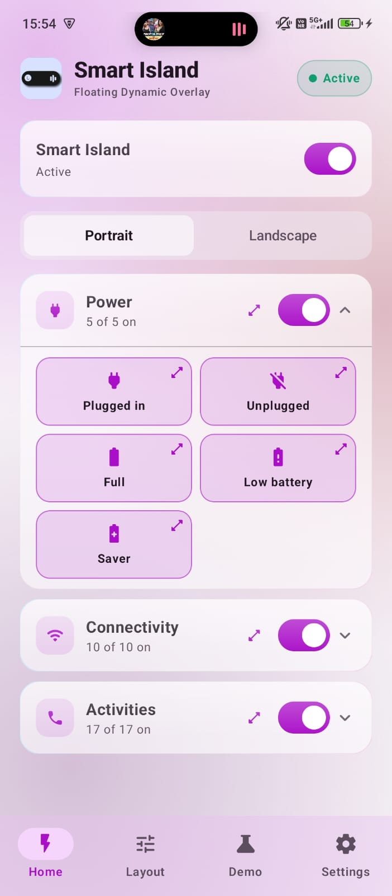
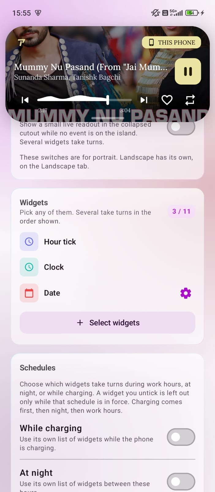
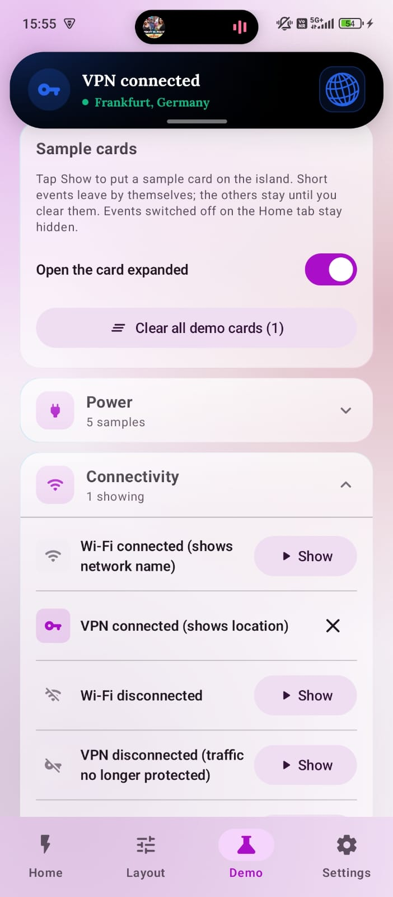
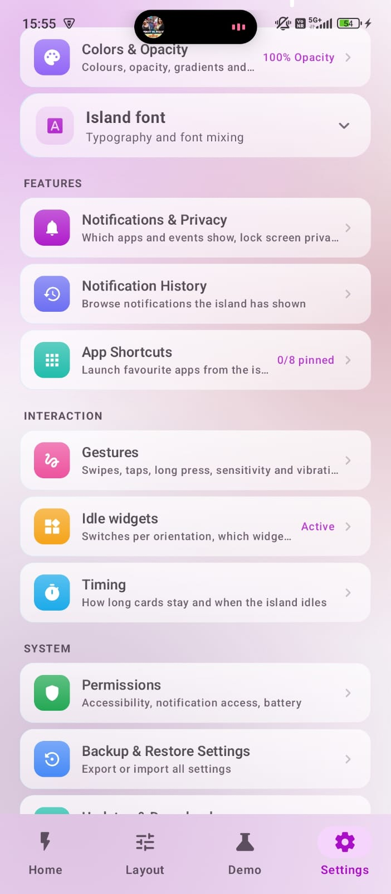
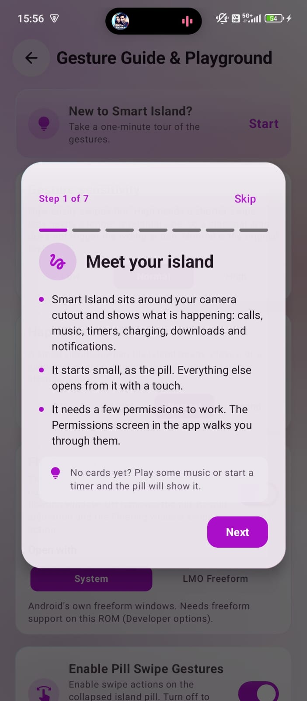

<p align="center">
  
</p>

<h1 align="center">Smart Island</h1>

<p align="center">
  <strong>A lightweight, privacy-first Android overlay that shows notifications, media, calls and more around your camera cutout.</strong>
</p>

<p align="center">
  <a href="https://github.com/agupta07505/SmartIsland/releases">
    
  </a>
  
  
  <a href="https://github.com/agupta07505/SmartIsland/actions/workflows/build.yml">
    
  </a>
  <a href="https://telegram.me/SmartIslandApp" target="_blank">
    
  </a>
  <a href="https://www.virustotal.com/gui/file/c07da408e7fa3e3fdeb25ec6415af07f1d56eff099840221138e9364c6065102/details" target="_blank">
    
  </a>
</p>

<p align="center">
  <a href="#what-it-is">What it is</a> &bull;
  <a href="#what-it-does">What it does</a> &bull;
  <a href="#screenshots">Screenshots</a> &bull;
  <a href="#privacy--permissions">Privacy</a> &bull;
  <a href="#building-from-source">Build</a> &bull;
  <a href="#community">Community</a>
</p>

---

## What it is

Smart Island puts a small pill around your camera cutout or status bar. Notifications, music, calls, charging, timers and navigation show up in it, and a tap opens each one into a card. When nothing is going on, a clock, the weather, your net speed or the next alarm take turns in the same spot.

Everything happens on your device. There is no account, no analytics and no cloud.

---

## What it does

### Notifications and live activities

Notifications show up as a small pill and open into a card with the app icon, the message and its action buttons. You can **reply inline**, and a half-typed reply is kept if a call or something else takes over the island. Alerts from the same app are **grouped into one card** with a small bubble to flip between them, and pictures in a notification open in steps from a preview to full size.

Other things it picks up and shows:

- **Music** with album art, a wavy seek bar and track controls
- **Calls**, including **WhatsApp, Telegram and other VoIP calls**, with a call timer
- **Timers and stopwatches** from Google, Samsung, Xiaomi, Oppo and Huawei clock apps, with pause, resume and laps
- **Navigation** with the next turn, distance left and ETA
- **Rides and deliveries** from Uber, Swiggy, Zomato, Blinkit, Rapido and Ola
- **Downloads, uploads, backups, file copies and app installs** with live speed and time left
- **System events** like charging, low battery, battery saver, Wi-Fi, VPN, Bluetooth (with **earbud battery**), USB, headphones, hotspot, flashlight and screen or audio recording

There are about **30 events** and each has its own switch. Portrait and landscape can be set separately.

### Idle widgets

When nothing is going on, the cutout rotates through small widgets you pick: **clock, date, weather, wind, battery, next alarm, net speed, unread count and Do Not Disturb**. Tapping one opens more detail. The date widget shows your **next calendar event**, and the weather one can list rain chance, humidity, UV, air quality, sunrise and sunset and the next few hours.

Some details worth knowing:

- The pill does a small **tick on the hour**, and sunrise, noon, sunset and midnight each get their own glyph.
- **Weather** uses your location or a city you choose, Open-Meteo by default, or your own compatible service.
- **Net speed** only shows when traffic is above a threshold you set, can be limited to Wi-Fi or mobile data, and keeps a **daily usage count**.
- You can hide or show widgets during **work hours, at night or while charging**, drag them into your own order and **pin one to always come first**.
- The tick can be smooth or drawn on a little **LED board** in red, amber, green or white.

### Unlock animation

When you unlock the phone, a **face scan animation** plays over the cutout, with a **fingerprint version** for finger unlocks and app locks. This one is still being built in phases.

### Gestures

The collapsed pill takes **swipes in all four directions**, so you can skip a track, cycle notifications or clear them without opening it. On an expanded card you can tap to open the app, swipe up to dismiss, **hold and swipe up to clear everything**, or swipe down for a **floating window** or the notification shade. Every direction can be remapped or turned off, and sensitivity and haptic strength are adjustable. There is a gesture guide with a small playground to try them.

### Quick launch

A launcher window opens from the island with **pinned apps, recents and a utilities grid**. The grid has Wi-Fi, Bluetooth, hotspot, airplane mode, dark mode, flashlight, calculator, timer, stopwatch, screenshot, screen and voice recorders, camera and clear cache, plus **resizable app widgets**. Floating windows use Android's own freeform mode, or **LMO Freeform** if your ROM has it.

### Looks and layout

The app is built with **Material 3**, so settings, switches and dialogs match the rest of Android, and colours can follow your wallpaper with **Material You** on Android 12 and up.

- **Size, position and corner radius** are set separately for portrait and landscape, with presets for a centre hole, corner hole, wide island or compact pill.
- A **top-docked notch mode** sits flush against the edge, and the companion bubble can go on the left or right.
- **Custom colours and opacity**, **custom fonts** (any TTF or OTF), or a mix of up to three fonts by weight.
- **Animation speed** presets, plus a **landscape lab** to preview how the island behaves when you rotate.
- A **settings search**, and **backup and restore** to a file.

### Notification control

- **Cooldown** for apps that send bursts of alerts, and background sync pings are ignored.
- **Do Not Disturb** and Android modes are respected.
- **Per-app rules** for showing, sound or hiding, and an **exempt list** that switches the island off in games or video.
- **Lock screen presets**: everything, messages only, calls only or off.
- **Privacy dots** for camera, mic, location and screen sharing, like Android's own, and a tap shows which app.
- A **local, searchable history** of past notifications that never leaves the phone.

### Staying alive

**Shizuku** can set up the awkward permissions in one tap. There are tips for **Xiaomi, Samsung, OnePlus, Oppo, Huawei, Vivo, Asus and Nubia** so the system does not kill the service, and a baseline profile helps keep animations smooth. Tap the version seven times to unlock **developer mode** with diagnostics and log export.

### Languages

Smart Island is translated into **Spanish, Japanese, Brazilian Portuguese, and Simplified Chinese** in addition to English.

Translations live in `app/src/main/res/values-<locale>/`. If you would like to help translate into another language or polish existing phrases, see [CONTRIBUTING.md](CONTRIBUTING.md). An automated helper script is included at [`scripts/translate_strings.py`](scripts/translate_strings.py) powered by LibreTranslate.

---

## Screenshots

<p align="center">
  
  
  
</p>

<p align="center">
  
  
  
</p>

---

## Privacy & permissions

Smart Island asks for what it needs to do its job and nothing more:

- **Overlay and notification access** to draw the island and read alerts, media and timers.
- **Foreground service and battery optimisation** so Android keeps it alive.
- **Usage access, Shizuku** (optional) for one-tap setup and the privacy indicator app inspector.
- **Calendar, location and Bluetooth** only for the widgets that use them: next event, weather, and earbud battery.
- **Internet** only for the update check you choose to run and the weather lookup. No notification content ever leaves the device.

More in [PRIVACY.md](PRIVACY.md) and [SECURITY.md](SECURITY.md). You can also check a build on [VirusTotal](https://www.virustotal.com/gui/file/c07da408e7fa3e3fdeb25ec6415af07f1d56eff099840221138e9364c6065102/details) or follow the public CI runs.

---

## Building from source

You need the Android SDK (API 26 to 36), JDK 17 and the bundled Gradle wrapper.

```bash
git clone https://github.com/agupta07505/SmartIsland.git
cd SmartIsland
./gradlew assembleDebug
adb install -r app/build/outputs/apk/debug/app-debug.apk
```

On Windows use `gradlew.bat`. Tests and lint run with `./gradlew testDebugUnitTest lintDebug`.

It is written in Kotlin with Jetpack Compose and Material 3, uses Hilt for injection, and keeps settings in DataStore and history in SQLite.

---

## Community

Come say hi on [Telegram](https://telegram.me/SmartIslandApp). Plans live in [ROADMAP.md](ROADMAP.md), history in [CHANGELOG.md](CHANGELOG.md), and contributions are welcome, see [CONTRIBUTING.md](CONTRIBUTING.md) and the [code of conduct](CODE_OF_CONDUCT.md).

---

## License

Smart Island is licensed under the [GNU General Public License v3.0](LICENSE).  
Copyright (C) 2026 **Animesh Gupta**.
