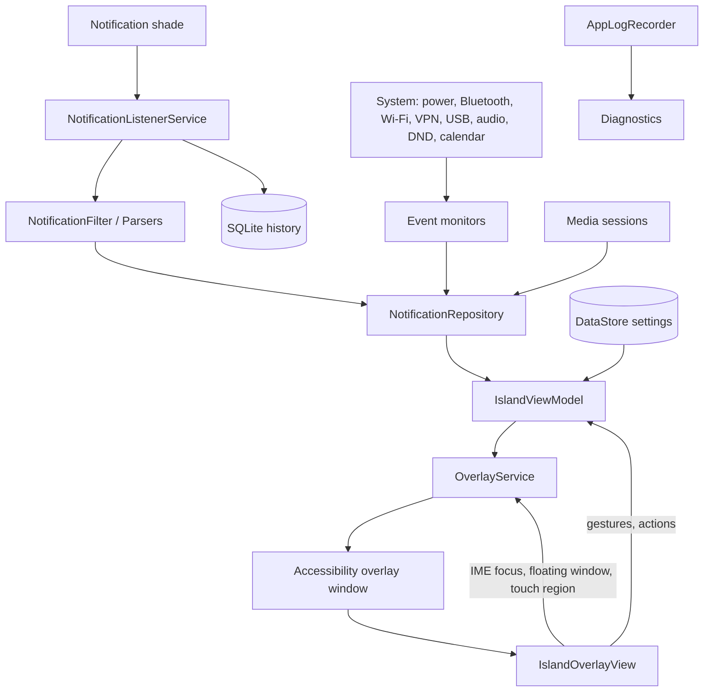

# Smart Island: Technical Analysis

Reference for how the app is built, as of the dev branch (the 7.5.0 work). Source paths are relative to `app/src/main/java/com/agupta07505/smartisland/` unless stated.

---

## 1. Overview

Smart Island is an Android app that draws a pill around the camera cutout and fills it with notifications, media, calls, timers, system events and idle widgets. It reads the notification shade through a notification listener, draws through an accessibility overlay, and renders everything with Jetpack Compose.

| | |
| :--- | :--- |
| **Code** | 326 Kotlin files, about 75k lines |
| **Tests** | 172 JVM unit test files, 1 instrumented smoke test |
| **Platform** | `minSdk 26`, `targetSdk` and `compileSdk 36`, Kotlin with JVM 17 |
| **Localisation** | English, Chinese (`zh`, `zh-rCN`), Portuguese (`pt`, `pt-rBR`) |

---

## 2. Build & Infrastructure

### Modules and toolchain

- `:app` is the application. `:baselineprofile` generates the startup and animation profile.
- Plugins: Android application, Kotlin Android, Kotlin Compose compiler, kapt, Hilt, AndroidX baseline profile.
- Dependency repositories are fixed to Google and Maven Central (`FAIL_ON_PROJECT_REPOS`).

| Area | Library |
| :--- | :--- |
| UI | Compose BOM 2026.02.01, Material 3, extended icons, activity-compose |
| Lifecycle | lifecycle-runtime, lifecycle-service, viewmodel-compose |
| DI | Hilt 2.60.1 (kapt) |
| Storage | DataStore Preferences, SQLite (history) |
| Privileged access | Shizuku API and provider 13.1.5 |
| Hidden APIs | LSPosed HiddenApiBypass 6.1 (touch-through region) |
| Performance | ProfileInstaller, committed `baseline-prof.txt` (`saveInSrc`, `mergeIntoMain`) |
| Tests | JUnit 4, MockK, coroutines-test, Turbine |

### CI (`.github/workflows`)

| Workflow | Job |
| :--- | :--- |
| `build.yml` | Build and Telegram notification on push to `main` and `dev` (markdown and assets ignored) |
| `build_pull_request.yml` | Build check for pull requests |
| `release.yml` | Version check, release build, publish, issue notifications |
| `baseline-profile.yml` | Generates the baseline profile |
| `auto-review.yml` | Automated pull request and issue review |
| `telegram-notifications.yml`, `notify_telegram.py` | Community notifications |
| `cleanup.yml` | Repository housekeeping |

Supporting files: `docs/` (release signing, Telegram setup), `scripts/` (keystore export, icon generation, Telegram sender) and the `.github` issue, PR and Copilot templates.

---

## 3. Runtime Components

| Component | Type | Role |
| :--- | :--- | :--- |
| `SmartIslandApp` | `Application` (Hilt) | Restores the log, installs the crash logger, applies hidden API exemptions |
| `MainActivity` | Activity | Settings app (Compose) |
| `ui/pickers/PickerActivity` | Activity | See-through window for the app and utility pickers, so choosing never opens the app |
| `SmartIslandOverlayService` | `AccessibilityService` and foreground service (special use) | Owns the overlay window, the ViewModel and the event sources |
| `SmartIslandNotificationListenerService` | `NotificationListenerService` | Reads, filters and classifies notifications |
| `AutostartReceiver` | Receiver | Restarts on boot, package replace and user present |
| `TimerActionReceiver`, `StopwatchActionReceiver` | Receivers | Timer and stopwatch buttons from the island |
| `ShizukuProvider` | Provider | Shizuku binder entry |

---

## 4. Data Flow

Everything flows one way: sources write cards to the repository, the ViewModel combines them with settings, and the overlay renders the result. User actions go back through the ViewModel and the service.

---

## 5. Services

### 5.1 `SmartIslandOverlayService`

- **Window:** adds a `ComposeView` with `TYPE_ACCESSIBILITY_OVERLAY` and supplies its own lifecycle, ViewModel and saved-state owners (`service/OverlayViewTreeOwners.kt`) because it runs outside an Activity.
- **Touch pass-through:** a reflected insets listener limits touches to the pill when collapsed and to the full frame when expanded. Hidden API exemptions make this work across ROMs.
- **Keyboard focus:** switches window flags while an inline reply is being typed, then restores pass-through.
- **Accessibility windows:** tracks the notification shade, quick settings, lock screen and the foreground app, so the island hides, resizes or switches off for exempt apps.
- **Owns these event sources:** system events, connectivity, wired devices, the network-speed fallback and the face unlock watcher.
- **Launches:** floating windows (Android freeform or LMO Freeform), the notification shade and the pinned apps and utilities.
- **Recovery:** `SystemServiceRecovery` reconnects the listener and accessibility service after a force stop.

### 5.2 `SmartIslandNotificationListenerService`

- Applies `NotificationFilter` (sync polls, wearable chatter, group summaries, torch), then classifies each notification into an `IslandMode`.
- Uses specialised parsers: `TimerStopwatchParser`, `NavigationParser`, `LiveActivityParser`, `TransferDetector` and `TransferClassifier`, `HotspotUtil`, `VoipCallDetector`.
- Owns the media session watcher and the VoIP call monitor, and reads media information from the notification's session token or the active controllers.
- Applies `NotificationCooldownManager` (per-app burst limit) and Do Not Disturb suppression.
- Keeps stale cards from appearing after a rebind and sweeps cards stuck after an unbind (`StaleCardSweep`).
- Writes the notification history and feeds the unread count for the idle widget.

### 5.3 Event sources (`service/` and `util/`)

| Source | Produces |
| :--- | :--- |
| `SystemEventReceiver` | Charging, battery level, battery saver, Bluetooth, flashlight and similar broadcasts |
| `ConnectivityEventMonitor` | Wi-Fi and VPN connect and disconnect |
| `WiredDeviceEventMonitor` | USB and wired headphone plug events |
| `VoipCallMonitor` (listener) | VoIP calls through the audio mode, with no extra permission |
| `MediaSessionWatcher` (listener) | Playback snapshots for the music card |
| `FaceUnlockWatcher`, `FaceUnlockCoordinator` | Face and fingerprint unlock phases |
| `IdleWidgetData` (UI) | Live values for the idle widgets (weather, net speed, battery, alarm, calendar, DND) |
| `TransferSpeedMonitor` | Network-speed fallback card for transfers without a notification |

---

## 6. State & Persistence

- **Settings:** `SmartIslandSettings` (200+ fields) stored through `SmartIslandSettingsRepository` in DataStore, exposed as a `Flow`. `OrientationProfile` separates portrait and landscape values.
- **Notifications:** `SmartIslandNotificationRepository` holds the live cards. It is injected through Hilt (`di/AppModule.kt`) and reached from services through an entry point (`di/SmartIslandRepositories.kt`).
- **History:** `NotificationHistoryDbHelper` (SQLite, one table with time and package indexes) behind `NotificationHistoryRepository`.
- **Other stores:** daily network usage (`NetUsageStore`) and custom fonts copied to `files/fonts`. Pinned apps and the utilities layout are saved inside the settings.
- **Backup and restore:** JSON through the Storage Access Framework with bounds validation and a single atomic restore. Custom fonts and the weather API key are never included.

---

## 7. UI Layer

### 7.1 Island shell (`ui/`)

| Area | Files |
| :--- | :--- |
| Composition root | `IslandOverlayView`, `OverlayIsland`, `IslandLayout`, `IslandGeometry` |
| Shell and gestures | `IslandMainGestures`, `IslandSwipeActions`, `IslandInteractionState`, `IslandShellModifiers` |
| Collapsed content | `IslandCollapsedContent`, `IslandPillSurface`, `IslandCornerPill` |
| Secondary cutouts | `IslandSecondary`, `IslandSecondaryBubble`, `IslandTertiaryPill`, `GooeyMerge`, `MergeBubble` |
| Expanded host | `IslandCardHost`, `IslandCardHeight`, `PrewarmedCard` |
| Landscape | `LandscapeLayout`, `LandscapePillExit` |
| Theme | `Theme.kt`, `glass/LiquidGlass.kt`, `IslandFonts.kt` |

Layout values live in `IslandLayout` and animated values are read inside draw and layout lambdas, so one animation frame does not recompose the whole overlay.

### 7.2 Cards (`ui/expanded/`)

One composable per mode: notification (inline reply, reader, picture selector), call, music (output chip, shade layout), battery, Bluetooth, hotspot, flashlight, navigation, live activity, download, timer, stopwatch, recorders and the utilities and launcher pages. `SiblingPicker` and `PictureIsland` handle several cards from one app.

### 7.3 Idle widgets and unlock

- `IdleWidgets`, `WidgetIsland`, `WeatherTick`, `TickPill`, `HourChime`, `DayMoment`, `LedTickSlot` and `LedRaster` draw the idle rotation, the hourly tick and the LED style.
- `FaceIdLayer`, `FaceIdFingerprint`, `FaceIdShapes` and `FaceIdCutoutLayer` draw the unlock animations over the cutout.

### 7.4 Settings app

`SmartIslandHomeScreen` has four tabs (Studio, Position, Demo, Settings) and detail pages for notification rules, shortcuts, history, colours, gestures, permissions, backup, diagnostics, timing, idle widgets (weather, net speed, calendar), face ID, updates, support, about and developer options. `ui/search/` indexes every setting for in-app search, and `DemoSection` and `LandscapeLabSection` replay sample events.

---

## 8. Pure Logic (`model/`)

62 files hold rules with no Android types, which is why most of them have unit tests: idle widget order and schedules, hour tick and day moments, LED ticks, weather and net speed rules, lock screen presets, card priority and same-app grouping, pill presence and exit motion, split island motion, rotation veil, utility grid, launcher paging and swipe actions. Animation timings are kept in `util/IslandTimings` and `util/SwipeFeel`.

---

## 9. Diagnostics & Privileged Access

- **`AppLogRecorder`:** in-memory ring buffer (3,000 entries) with a disk copy that survives the process being killed, crash recording and a main-thread watchdog. Exported as text through the Storage Access Framework.
- **Diagnostics section:** records a missed call or notification, adds an environment snapshot (listener, overlay, battery, DND, audio mode), then exports the report.
- **`ShizukuManager`:** detects Shizuku, Sui and forks, grants overlay, usage, battery and sensitive notification permissions, runs read-only shell commands, repairs the accessibility service and toggles the hotspot.
- **`OemDeviceRules` and `OemAutostartUtil`:** vendor-specific autostart and cutout rules for Xiaomi, Samsung, OnePlus, Oppo, Huawei, Vivo, Asus and Nubia.

---

## 10. Testing

- `app/src/test`: 172 test files covering model rules, parsers, settings, repositories, layout and motion maths, gesture mapping and merge animation.
- `app/src/androidTest`: `IslandOverlaySmokeTest`.
- `baselineprofile`: `BaselineProfileGenerator`, run on a connected device because the overlay needs permissions a managed device cannot hold (`./gradlew :app:generateBaselineProfile`).

---

## 11. Key Flows

| Action | Flow |
| :--- | :--- |
| New notification | Listener filters and classifies it, repository stores the card, ViewModel orders it, the pill pulses and expands if auto-expand allows |
| Tap the pill | Shell expands, height follows the card, content fades in |
| Pill swipe | Gesture maps to a `SwipeAction`: cycle cards, skip track, dismiss, shade, floating window |
| Reply inline | Service gives the window keyboard focus, `RemoteInput` sends, the draft is cleared |
| Unlock | Watcher reports the phase, coordinator runs the scan and result animation over the cutout |
| Nothing active | Pill falls back to the idle rotation, filtered by the work, night and charging schedule |
| Rotate | Veil hides the island, orientation settles, the matching profile is applied |
| Process killed | Autostart and service recovery rebind, the log restores from disk |
